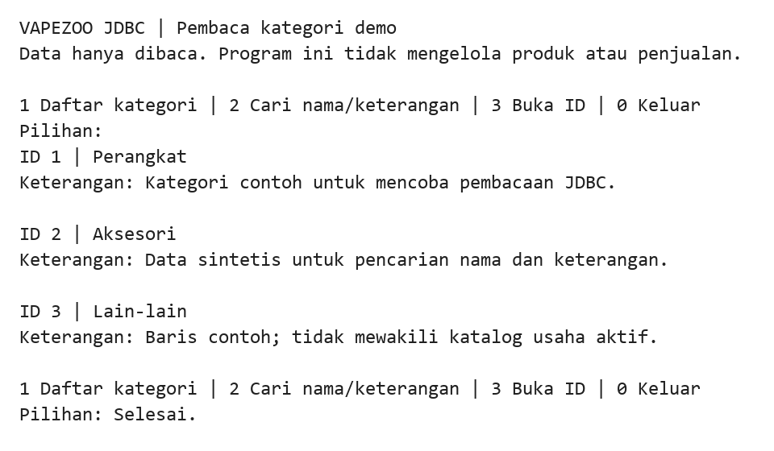

# VapeZoo JDBC Category Reader

Latihan **Java 17 dan JDBC/MySQL** untuk membaca kategori: tampilkan daftar, cari nama/keterangan, atau buka satu ID. Program berjalan di terminal. Akun database demo hanya diberi izin `SELECT`.

Proyek ini melanjutkan pembaca tabel `category` dari `backend-rafik`/`backend_vapezoo`. Cakupannya kategori saja; tidak ada CRUD produk, akun pelanggan, keranjang, pembayaran, atau layanan HTTP. [NOTICE.md](NOTICE.md) menjelaskan asal sumber.

## Contoh keluaran terminal



Transkrip hasil eksekusi JAR pada MySQL 8.4 dengan tiga kategori sintetis, dirender menjadi gambar. Masukan `1` menampilkan daftar dan `0` keluar; masukan stdin tidak ditampilkan ulang.

## Build dan tes

Gunakan JDK 17 serta Maven 3.9 atau lebih baru:

```powershell
git clone https://github.com/zalamanga/vapezoo-jdbc-java.git
cd vapezoo-jdbc-java
mvn verify
```

Hasilnya `target/vapezoo-jdbc-java.jar`, termasuk driver MySQL. Tes memakai database H2 dalam memori; tidak membuka database pengguna.

## Siapkan database demo

Docker Compose di repo ini menjalankan **database MySQL**, sedangkan aplikasi terminal dijalankan dengan Java di Windows:

```powershell
Copy-Item .env.example .env
```

Isi dua password berbeda pada `.env`, lalu jalankan:

```powershell
docker compose up -d --wait
```

Database baru berisi tiga kategori sintetis. Port `18807` hanya dibuka pada localhost. Jangan arahkan percobaan ini ke database usaha asli; schema contoh bukan migrasi database lama.

Atur environment pada terminal yang akan menjalankan JAR:

```powershell
$env:DB_URL = 'jdbc:mysql://localhost:18807/vapezoo_categories?connectionTimeZone=UTC&connectTimeout=3000&socketTimeout=5000'
$env:DB_USER = 'category_reader'
$env:DB_PASSWORD = 'isi-nilai-DB_PASSWORD-dari-file-env'
java -jar target/vapezoo-jdbc-java.jar
```

`.env` dibaca Compose, bukan otomatis oleh Java. Nilai `DB_PASSWORD` pada proses Java harus sama dengan yang kamu isi di `.env`. Untuk MySQL mandiri, buat schema dan user pembaca secara terpisah dengan struktur pada `database/001-schema.sql`; skrip tersebut juga mengatur izin user demo yang dibuat Compose.

## Menu

| Pilihan | Fungsi |
| --- | --- |
| `1` | Daftar kategori sesuai ID. |
| `2` | Cari sebagian nama/keterangan tanpa membedakan huruf besar/kecil. `%` dan `_` dibaca sebagai teks biasa. |
| `3` | Buka kategori berdasarkan ID positif. |
| `0` atau akhir input | Keluar. Akhir input saat mengisi pencarian juga mengakhiri program. |

Input tidak valid kembali ke menu. Hasil kosong dan ID yang tidak ditemukan memiliki pesan tersendiri. Jika database tidak tersedia, program menampilkan kode SQL yang aman dan menerima percobaan ulang; detail password/koneksi tidak dicetak. Semua query memakai parameter dan resource JDBC ditutup setelah operasi.

## Menghentikan demo

```powershell
docker compose down
```

Volume data dipertahankan. Schema/seed hanya dijalankan saat volume pertama dibuat; mengubah `.env` tidak mengubah password akun database yang sudah terbentuk. Jika port bentrok, ubah pemetaan port Compose dan sesuaikan port pada `DB_URL`.

## Struktur

```text
src/main/java/id/vapezoo/categories/
  Main.java                 Entry point dan environment
  Database.java             Koneksi JDBC dengan penanda read-only
  CategoryRepository.java   Pembacaan dan pencarian berparameter
  ConsoleApp.java           Menu, validasi dan pesan terminal
  Category.java             Data kategori
src/test/java/              Tes pencarian, penutupan koneksi dan alur terminal
database/001-schema.sql     Schema dan data contoh, izin user SELECT
compose.yaml                MySQL demo
```

Versi asal menjalankan query daftar dua kali dan tidak menutup koneksi, statement atau result set. Versi ini menjalankan satu query per pilihan dan memisahkan tampilan terminal dari akses database. Penanda JDBC read-only membantu menyatakan maksud koneksi; pembatasan izin `SELECT` tetap perlu diterapkan pada user database yang kamu gunakan.
