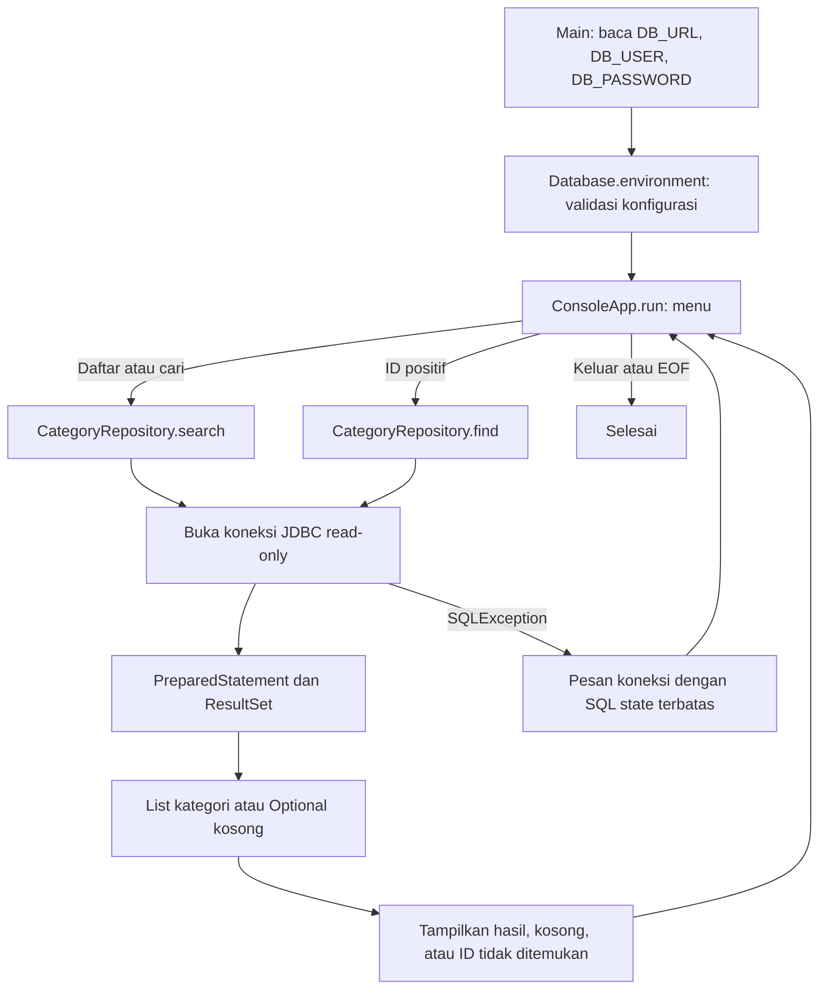

# Alur kode pembaca kategori VapeZoo

Program hanya membaca kategori MySQL. Pilihan terminal diterjemahkan menjadi query berparameter; akun database demo dibatasi pada izin `SELECT` oleh SQL setup.

`search` memakai `LOCATE` terhadap nama dan keterangan yang dinormalisasi ke huruf kecil. `%` dan `_` tetap teks biasa. `try-with-resources` menutup koneksi, statement dan hasil query setelah operasi. Penanda read-only JDBC menyatakan maksud aplikasi; izin akun database tetap menjadi pembatas akses yang sebenarnya.

| Bagian | Sumber |
| --- | --- |
| Entry point | [Main.java](../src/main/java/id/vapezoo/categories/Main.java) |
| Koneksi dari environment | [Database.java](../src/main/java/id/vapezoo/categories/Database.java) |
| Query daftar/cari/ID | [CategoryRepository.java](../src/main/java/id/vapezoo/categories/CategoryRepository.java) |
| Menu dan keadaan hasil | [ConsoleApp.java](../src/main/java/id/vapezoo/categories/ConsoleApp.java) |
| Tabel, seed sintetis dan izin SELECT | [001-schema.sql](../database/001-schema.sql) |
| Regresi query, penutupan resource, input dan retry | [CategoryReaderTest.java](../src/test/java/id/vapezoo/categories/CategoryReaderTest.java) |

Tidak ada penulisan kategori, CRUD produk, layanan HTTP, atau proses pembayaran. Setup database/JAR ada di [README](../README.md).
